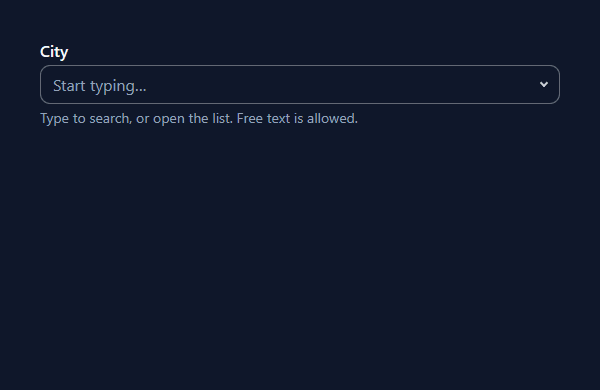

# werkbank

**Live demos: <https://webartelier.codeberg.page/werkbank/>**

[](https://webartelier.codeberg.page/werkbank/src/components/comboBox/demo.html)

A collection of small, self-contained, framework-free UI components built on
modern web platform features. Each component is plain JavaScript (ES modules)
plus SCSS, wired to the page through a tiny loader — no framework, and one
single third-party library in the whole collection (`slider` uses
[Swiper](https://swiperjs.com), bundled and self-hosted; nothing is ever
fetched from a CDN at runtime).

The collection is both a **component library to copy from** and a **workbench**:
every component ships with a live demo, a copy-paste snippet and its own
readme, and `index.html` at the project root is a gallery linking to all demos
— the same gallery that is online at the link above.

## Quick start

- **Look first:** every component runs in the
  [online gallery](https://webartelier.codeberg.page/werkbank/).
- **Use one:** add `shared.min.css`, the component's stylesheet and
  `boot.min.js` to your page, then paste the markup from the component's
  snippet — see [Using a component](#using-a-component-in-your-own-project).
- **Run it locally:** `git clone https://codeberg.org/webARTelier/werkbank.git`,
  serve the folder with any static server and open `index.html` — see
  [Demos](#demos). `dist/` is committed, so no build is needed until you
  change a source file.

## Who it's for

- **Agencies and freelancers in client work.** If you ship many different
  sites — often on a CMS like WordPress, TYPO3 or Shopware — and don't want to
  reinvent the accordion, dialog or tabs each time (nor pull a full framework
  into every project), these are ready-made blocks that drop into any stack,
  because they sit on plain HTML/CSS/vanilla JS.
- **Teams betting on the web platform.** For everyone who deliberately builds
  progressive-enhancement-first — HTML works without JS, CSS carries as much
  as it can (native Popover API, anchor positioning, `IntersectionObserver`,
  container queries) — and would rather stay on standards than on the
  framework upgrade treadmill.
- **The performance- and accessibility-conscious.** Per-component lazy loading
  keeps the eager payload tiny, and ARIA, keyboard operation and a visible
  focus ring are built in, not bolted on — a real time saver under a strict
  performance budget or WCAG requirements.
- **Learners and architecture-minded developers.** The clear conventions
  (camelCase, the component-standards checklist), the DI-vs-direct-import split
  and the modern build make this a readable, MIT-licensed reference for
  structuring maintainable vanilla-JS components.

Where it fits less well: teams deep in React, Vue or Angular that want a
state-driven design system with component props — there, the HTML-attribute
approach (`data-js-behavior="…"`) is more friction than help.

## Philosophy

### Progressive enhancement

The native platform is the source of truth; JavaScript only fills the gaps.
Components build on `<details>`/`<summary>`, `<dialog>`, the Popover API, the
Constraint Validation API, `IntersectionObserver`, `ResizeObserver`,
`@starting-style` transitions, and so on — instead of reimplementing them.

- **Without JavaScript the markup stays usable.** An accordion still opens and
  closes, a form still validates, anchor links still navigate.
- **JS never writes inline styles for state.** It toggles state classes or
  data attributes (`is-invalid`, `has-neighbor`, `aria-expanded`) and the CSS
  reacts. This keeps behaviour and presentation cleanly separated.
- **Animations are pure CSS enhancements** — older engines simply snap, and
  every animated component respects `prefers-reduced-motion`.

### Accessibility

Accessibility is non-negotiable, not a feature flag:

- State is reflected into ARIA following the ARIA APG pattern for each widget
  (`aria-expanded`, `aria-controls`, `aria-invalid`, `aria-current`, roles).
- Keyboard focus is visible via a shared, per-element `focus-ring()` mixin
  with tones for dark and light surfaces.
- Decorative generated output is hidden from assistive technology
  (`aria-hidden="true"`, `focusable="false"`); focusable regions always get an
  accessible name.

### Lean loading

One tiny script, `boot.min.js`, is the only eagerly loaded JS. It scans the
page for `data-js-behavior="…"` attributes and lazy-loads each component's
chunk only when the markup actually asks for it. A page that uses two
components downloads two chunks — nothing else.

## Components

The **role** column says what a piece is in BEM terms: a **module** (`m-`) is
*placed* and occupies a region of the page, a **component** (`c-`) is
*attached* to a host that is complete without it, and a **function** owns no
vocabulary at all — it only enhances existing markup, so the look belongs to
your project. Seven functions ship a ready-made look alongside them anyway;
the class in brackets is that offer, and the behaviour neither needs nor
reads it. The full decision rule is in [`CLAUDE.md`](CLAUDE.md).

| Component            | Role                          | What it does                                                        |
| -------------------- | ----------------------------- | ------------------------------------------------------------------- |
| `accordion`          | module                        | Expand/collapse panels on native `<details>`/`<summary>`.           |
| `adaptiveScrollFade` | function (`c-scrollFade`)     | Fade-out edges on scrollable containers, only where overflow is.    |
| `autoGrowTextarea`   | component                     | A `<textarea>` as tall as its value — CSS only, on `field-sizing`. |
| `backToTop`          | module                        | Jump back to the top, shown once the page is scrolled far enough.   |
| `comboBox`           | component                     | Typeahead listbox on a native `<input list>` + `<datalist>`.        |
| `conditionalFields`  | function                      | Opens a `<fieldset>` only while another field asks for it — out of the submit while closed. |
| `copyToClipboard`    | function                      | One press puts a string into the clipboard — announced, not only drawn. |
| `countdown`          | module                        | Live countdown to a target date/time.                               |
| `dataTable`          | component                     | Sortable columns on a plain `<table>`, scrolling or stacked.        |
| `dateInputFormat`    | function (`c-dateField`)      | Auto-formats a text field into a grouped date mask (`DD.MM.YYYY`).  |
| `dialog`             | component                     | Modal dialogs on the native `<dialog>` element.                     |
| `dropdownNav`        | module                        | Multi-level dropdown / mega-menu nav on the ARIA disclosure pattern.|
| `embedConsent`       | component                     | Holds a third-party embed's place until the visitor has allowed it.  |
| `fileUpload`         | component                     | A file field that names what is attached, with an upload lane.      |
| `filterList`         | function                      | Client-side search and facet filtering over a card or list group.   |
| `flexNeighborMarker` | function (`o-flexNeighbor`)   | Marks flex items that have a neighbour on the same row.             |
| `formValidation`     | function                      | Inline validation messages on the Constraint Validation API.        |
| `inlineSVG`          | function                      | Replaces `` SVG references with inline SVG.                    |
| `inputCharCount`     | function                      | Character-count display for inputs and textareas.                   |
| `lightbox`           | module                        | Image/gallery viewer on the native `<dialog>`, from image links.    |
| `loadFragment`       | function (`c-fragment`)       | Loads a region of another page into a box, from a real link.        |
| `marquee`            | module                        | Infinitely scrolling content strip (news ticker).                   |
| `numberInputFormat`  | function (`c-numberField`)    | Groups a number field while typing, in the page's language.         |
| `offCanvasNav`       | module                        | Burger menu / off-canvas drawer on the native `<dialog>`.           |
| `passwordToggle`     | component                     | Show/hide for a password field, by switching its `type`.            |
| `popover`            | component                     | Anchor-positioned popover on the native Popover API.                |
| `readMore`           | component                     | Long text cut to a preview, with the control that opens it.         |
| `revealOnScroll`     | function (`c-reveal`)         | Reveals items as they enter the viewport, via IntersectionObserver. |
| `scaleSVG`           | function                      | Scales SVGs from their `viewBox`.                                   |
| `scrollSpy`          | function                      | IntersectionObserver-driven TOC highlight via `aria-current`.       |
| `siteSearch`         | module                        | Site search form expanding out of a toggle, on `<search>`.          |
| `slider`             | module                        | Preset slider types an editor picks by name; Swiper inside, scroll-snap without it. |
| `stickyObserver`     | function (`c-stickyBar`)      | Sentinel-driven "is stuck" class toggle for `position: sticky`.     |
| `tabs`               | module                        | ARIA tabs enhancement of an anchor-link table of contents.          |
| `toast`              | module                        | Transient messages in a stack, announced via a live region.         |
| `tooltip`            | component                     | Hoverable, dismissible hint on a control, shown by CSS alone.       |
| `video`              | module                        | CMS-maintainable self-hosted video with responsive sources.         |

Each folder under `src/components/<name>/` contains exactly:

| File          | Purpose                                                    |
| ------------- | ---------------------------------------------------------- |
| `<name>.js`   | Behaviour. Exports `init(el, services)`; never self-runs.  |
| `<name>.scss` | Styles (stub for behaviour-only components).               |
| `<name>.html` | Copy-paste snippet with wiring notes.                      |
| `demo.html`   | Standalone live demo using the built `/dist` assets.       |
| `readme.md`   | Usage, options, accessibility and integration notes.       |

## Building

```sh
npm install
npm run build   # compile SCSS + bundle JS into dist/
npm run dev     # build + watch
npm run clean   # remove dist/
```

The Gulp + Rollup + Lightning CSS build produces:

- `dist/js/boot.min.js` — the eager loader (composition root).
- `dist/js/modules/<name>.min.js` — one lazy chunk per component, with any
  pure `_shared/js/` utilities bundled in.
- `dist/css/shared.min.css` — design tokens (colors, spacing, animation) and
  base styles; required on every page.
- `dist/css/<name>.min.css` — per-component styles.

`_shared/js/registry.js` is auto-generated from the module file names at
build time — never edit it by hand.

**Third-party code** is installed from npm, bundled into the component that
uses it and never fetched at runtime. Today that is one library: Swiper, in
`slider`. Its script lands inside `dist/js/modules/slider.min.js` and its core
stylesheet inside `dist/css/slider.min.css`, so a page that has no slider
downloads none of it and a page that has one still adds no CDN tag. The rules
for adopting the next one are in [`CLAUDE.md`](CLAUDE.md) ("Vendor code").

## Using a component in your own project

### 1. Full setup (recommended)

Include the shared CSS, the CSS of the components you use, and the boot
loader — then tag your markup:

```html
<link rel="stylesheet" href="/dist/css/shared.min.css" />
<link rel="stylesheet" href="/dist/css/accordion.min.css" />
<script type="module" src="/dist/js/boot.min.js"></script>

<div data-js-behavior="accordion">
  <!-- markup from src/components/accordion/accordion.html -->
</div>
```

That's all the wiring there is:

- `boot.min.js` finds every `[data-js-behavior]` element and lazy-loads the
  matching chunk. Never import a component's JS yourself.
- Multiple modules on one element are comma-separated:
  `data-js-behavior="accordion,scrollSpy"`.
- Behaviour is configured through `data-*` attributes documented in each
  component's `readme.md` and snippet — all optional where possible.
- For markup inserted after page load (AJAX, template render), import
  `initModulesInScope` from the boot module and call it with the new
  container; a per-element double-init guard makes repeated calls safe.
- For a host that mounts/unmounts the same markup repeatedly instead of
  doing a full page (re)load (a JS framework re-rendering, an SPA route
  change), import `destroyModulesInScope` too and call it with the
  outgoing container before it is removed. Components that hold state
  outside their own element (a `window`/`document` listener, a running
  timer, a sentinel appended elsewhere) return a cleanup function from
  `init()`; the loader stores and runs it. Components with no such state
  need not return anything and are simply skipped.

**Duplicated markup and page-wide id uniqueness.** Several components
resolve their target by an id-based selector evaluated against the whole
document (a dialog's open trigger, `scrollSpy`/`tabs` panel targets, an
element referenced by `data-sticky-sentinel`/`data-sticky-root`/
`data-spy-root`). On a page built from repeatable content elements — the
normal case in a CMS like TYPO3, where an editor can place the same
element (and therefore the same static markup) more than once on one
page — give every instance's ids a unique suffix (e.g. the content
element's own uid) so two instances never resolve to the same target.
`formValidation`'s CMS message block is the one exception: it is resolved
per-form (inside the form, then its immediate siblings, then page-wide),
so repeated forms do not need to worry about it.

Per-component theming happens through CSS custom properties: every stylesheet
declares its `--<name>-*` variables on the component root (e.g.
`.c-dialog { … }`), mapped to the shared tokens — override those instead of the
rules themselves, either in your own CSS or inline on the element itself. Two
behaviour-only components keep their tokens in `:root` because they own no root
element to scope them to (`formValidation`) or document the override on an
ancestor of the element that consumes them (`marquee`).

### 2. Cherry-picking single files

Components are deliberately self-contained, so you can also copy them into a
project that has its own asset pipeline. Each `readme.md` lists the files
under **"Files needed to copy"** — typically the `.js`, the `.scss` and any
pure utility from `src/_shared/js/` the component imports (e.g.
`rafThrottle.js`). `slider` is the one that also needs an npm install
(`swiper`), because a vendor library is a dependency and not a file to paste.
The JS exports a single `init(el, services)` and never
self-initializes, so it slots into any loader; `services.reporter` is
optional and only used for warnings — without it the module degrades
silently. `embedConsent` is the one that takes a second service,
`services.consent` (built in `boot.js`, see
[`createConsentGate.js`](src/_shared/js/createConsentGate.js)); it too is
optional, and without it the component's click lane is simply the only way
in.

Note for behaviour-only components (`tabs`, `formValidation`,
`inputCharCount`, …): they ship a stub stylesheet by design and leave all
visuals — including the focus style — to the consuming project.

## Dev tools

Next to the components sits a second, separate area: **development tools** in
[`src/tools/`](src/tools/). A tool is not a component — it is *pointed at* a
page rather than authored into one:

- **One file, one `<script>` line.** A tool is a single classic script with no
  imports and no build step. Its whole UI, CSS included, comes along inside a
  shadow root, so it drops into any page — a template you can only hang a
  script tag into, a console paste, a bookmarklet.
- **It never ships.** Tools have no output in `dist/`, no stylesheet in the
  build and no markup to author; they answer a question about the page you are
  building and are then taken off it again.
- **Nothing is fetched at runtime** — the QR code is encoded in the page
  itself — and what is written into the page carries a `data-dev-` name, so a
  grep finds any leftover. Apart from the strip of flow space the bar holds
  for itself, nothing is changed unless you ask for it.

Shipped: **`dev_dashboard`**, a bar along the bottom edge with one icon per
tool. It reads out the viewport and the project's four device tokens, marks
the a11y inspector and the horizontal-overflow check green or red with a
count, encodes the current URL as a QR code, and measures which `sizes` and
`srcset` widths the marked images actually need by sweeping a probe frame
across the viewport range. It has a
[readme](src/tools/dev_dashboard/readme.md);
[`docs/toolStandards.md`](docs/toolStandards.md) has the rules.

## Demos

The gallery links every component's `demo.html` — online at
<https://webartelier.codeberg.page/werkbank/>, and as `index.html` in the
project root.

Locally the pages need a **static server**: opened from `file://`, the browser
blocks the ES modules and no component ever starts. Any server will do —
`npx http-server . -p 8123`, VS Code's Live Server, or `npm run demo:upload`,
the one that ships with the project and also answers the upload examples in
`fileUpload`. `dist/` is committed, so `npm run build` is only needed after
you change a source file.

## Further reading

- [`docs/componentStandards.md`](docs/componentStandards.md) — the authoring
  checklist every component follows (file set, `init` contract, JS/SCSS
  style, accessibility, demo/readme structure).
- [`docs/toolStandards.md`](docs/toolStandards.md) — the much shorter
  checklist the `dev_*` tools follow: one file, one shadow root, the
  `window.__devTools` handle, and why a demo aid is a different species.
- [`docs/preEnhancement.md`](docs/preEnhancement.md) — how the flash between
  the first paint and `init()` is handled: the `data-<name>-ready` attribute,
  the `pre-enhancement()` mixin, and the rule that decides which components
  are allowed to hide something before their script has arrived.
- [`CLAUDE.md`](CLAUDE.md) — naming conventions, DI vs. direct import, and
  the focus-ring convention.

## License

[MIT](LICENSE) — use, copy and adapt freely; just keep the copyright notice.

<br><br>
